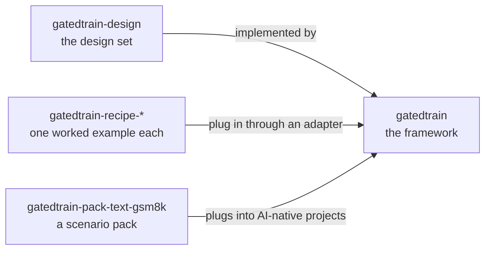

# gatedtrain

gatedtrain is a prototype post-training framework. It checks whether a newly trained model checkpoint is really
better than the model it started from. It
calls the new checkpoint better only when it beats a criterion registered before training (the metric, the margin,
the sample size and the evaluation seeds), on test data the trainer never saw; the report says PASS, FAIL,
INCONCLUSIVE or MISSING, with the achieved power. It also records which data each checkpoint consumed, so a data
defect can be traced to the checkpoints it reached.

It is for people who fine-tune models and want a decision they can defend.

**Start here:** the [documentation](https://gatedtrain.github.io/gatedtrain/) and its
[CPU quickstart](https://gatedtrain.github.io/gatedtrain/quickstart/). The framework is on PyPI: `pip install gatedtrain`.

## The repositories

- [`gatedtrain`](https://github.com/gatedtrain/gatedtrain): the framework, its adapter SDK and conformance kit.
- [`gatedtrain-design`](https://github.com/gatedtrain/gatedtrain-design): the design set the framework implements.
- [`gatedtrain-pack-text-gsm8k`](https://github.com/gatedtrain/gatedtrain-pack-text-gsm8k): a scenario pack for
  gatedtrain's AI-native projects (a preview): it trains a small model on GSM8K math questions on your GPU, while a
  separate service under its own OS user holds back part of the questions and runs the final test.
- `gatedtrain-recipe-*`: one repository per worked example (LLM, VLM, diffusion, video, speech, robotics, and
  control), each with its adapter, scripts, and the gate result of its published run:

| Task | Recipe |
|---|---|
| Math reasoning | [TRL GRPO on GSM8K](https://github.com/gatedtrain/gatedtrain-recipe-trl-grpo-gsm8k) |
| Drone control | [Stable-Baselines3 PPO](https://github.com/gatedtrain/gatedtrain-recipe-sb3-ppo-drone-hover) |
| Image generation | [DDPO with SD1.5](https://github.com/gatedtrain/gatedtrain-recipe-ddpo-sd15) |
| Image generation for OCR | [Flow-GRPO with SD3.5](https://github.com/gatedtrain/gatedtrain-recipe-flow-grpo-sd35-ocr) |
| Video generation | [Flow-GRPO with Wan](https://github.com/gatedtrain/gatedtrain-recipe-flow-grpo-wan-video) |
| Speech recognition | [Whisper SFT on AMI](https://github.com/gatedtrain/gatedtrain-recipe-whisper-sft-ami) |
| Text-to-speech | [CosyVoice DPO](https://github.com/gatedtrain/gatedtrain-recipe-cosyvoice-dpo-tts) |
| CAD | [NeMo RL for CAD](https://github.com/gatedtrain/gatedtrain-recipe-nemo-rl-cad) |
| Visual reasoning | [NeMo RL on CLEVR](https://github.com/gatedtrain/gatedtrain-recipe-nemo-rl-vlm-clevr) |
| Robot manipulation | [LeRobot SmolVLA on LIBERO](https://github.com/gatedtrain/gatedtrain-recipe-lerobot-smolvla-libero) |
| Agentic math | [NeMo RL for agentic math](https://github.com/gatedtrain/gatedtrain-recipe-nemo-rl-agentic-math) |

All repositories are Apache-2.0. Names of third-party projects and products are trademarks of their owners;
gatedtrain is not affiliated with or endorsed by them.
